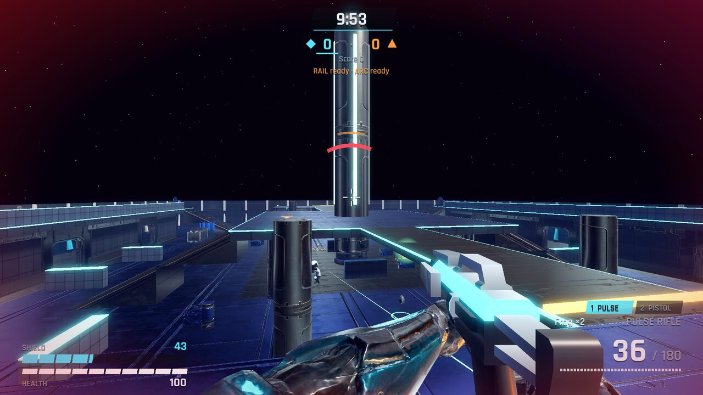
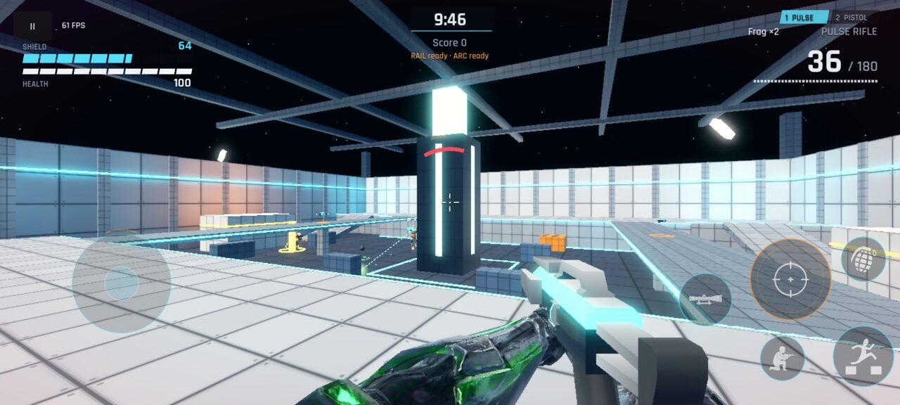
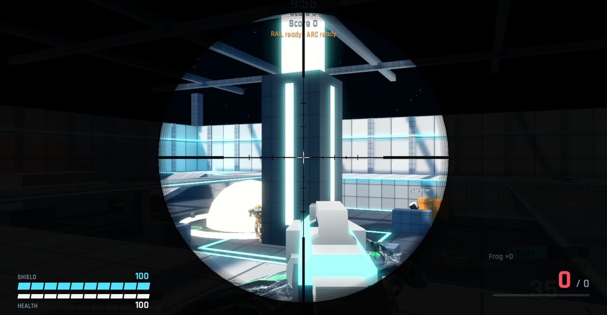
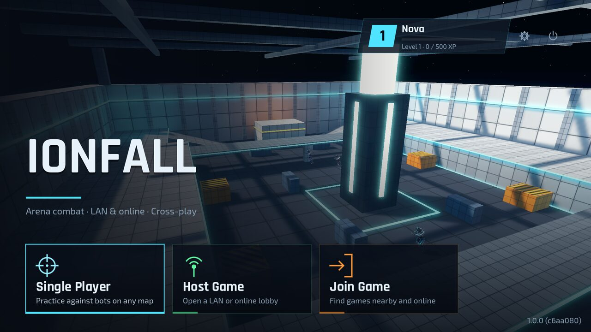
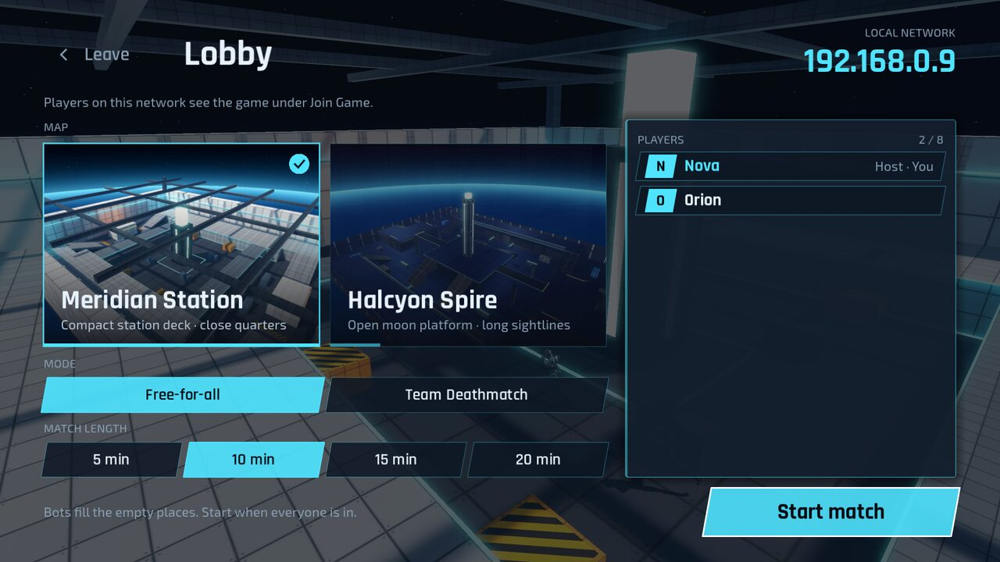
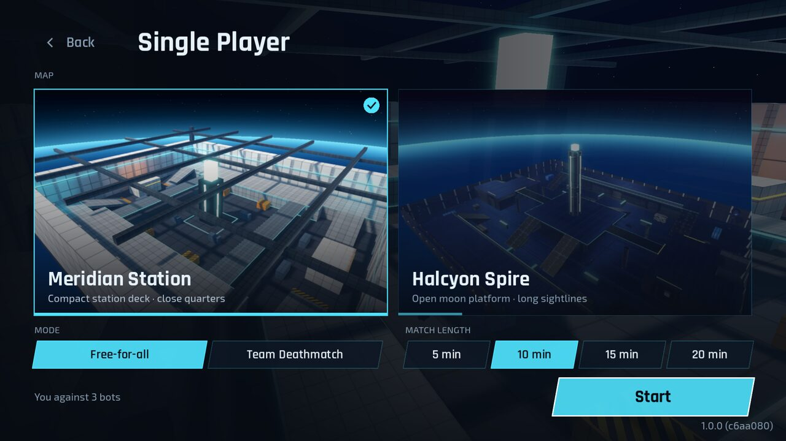
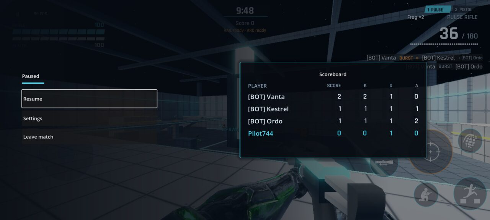

# IONFALL

A fast sci-fi arena shooter for **Android, Windows, Linux and the web**. Fight bots on your own,
or play with friends over the local network or the internet. Phones and PCs play in the same match.

**▶ [Play in your browser](https://aswinkumarks.github.io/IONFALL/play/)** (single player, no install) ·
[Website](https://aswinkumarks.github.io/IONFALL/) ·
**[Download v0.9](https://github.com/aswinkumarks/IONFALL/releases/tag/v0.9)** ·
[Roadmap](https://github.com/users/aswinkumarks/projects/5)



| | |
|---|---|
|  |  |
| *On Android: one thumb cluster around Fire, joystick on the left* | *Scoping in with the Rail Sniper* |
|  |  |
| *Home: Single Player, Host Game, Join Game* | *Lobby: the host picks map, mode and match length* |
|  |  |
| *Single player against bots on either map* | *Pause menu with the live scoreboard* |

## Try it in a minute

| Platform | How |
|---|---|
| **Web browser** | Open **https://aswinkumarks.github.io/IONFALL/play/**, click **Single Player → Start**, then click into the game to aim with the mouse. Desktop Chrome, Edge or Firefox recommended. |
| **Windows 10/11** (64-bit) | Download [`ionfall-0.9.0-windows.zip`](https://github.com/aswinkumarks/IONFALL/releases/download/v0.9/ionfall-0.9.0-windows.zip), unzip, run `IONFALL.exe`. The build isn't code-signed, so SmartScreen may warn: **More info → Run anyway**. |
| **Linux** (x86_64) | Download [`ionfall-0.9.0-linux.zip`](https://github.com/aswinkumarks/IONFALL/releases/download/v0.9/ionfall-0.9.0-linux.zip), unzip, run `./ionfall.x86_64`. |
| **Android 10+** (64-bit) | Download [`ionfall-0.9.0-android-arm64.apk`](https://github.com/aswinkumarks/IONFALL/releases/download/v0.9/ionfall-0.9.0-android-arm64.apk) on the phone and open it (allow installs from your browser or file manager). A Google Play release is coming with v1.0. |
| **Dedicated server** | [Linux](https://github.com/aswinkumarks/IONFALL/releases/download/v0.9/ionfall-0.9.0-server-linux.zip) or [Windows](https://github.com/aswinkumarks/IONFALL/releases/download/v0.9/ionfall-0.9.0-server-windows.zip) server for LAN matches of up to 16 players; see [docs/server.md](docs/server.md). |

Checksums are in [`SHA256SUMS`](https://github.com/aswinkumarks/IONFALL/releases/download/v0.9/SHA256SUMS).
Everyone in a match needs the same version.

### What works where

| | Windows | Linux | Android | Web |
|---|:---:|:---:|:---:|:---:|
| Single player vs bots | ✅ | ✅ | ✅ | ✅ |
| LAN multiplayer (host / join) | ✅ | ✅ | ✅ | — |
| Internet multiplayer (invite codes) | ✅ | ✅ | ✅ | — |
| Keyboard & mouse | ✅ | ✅ | — | ✅ |
| Touch controls | — | — | ✅ | — |

Browsers can't open the network connections LAN and internet play use, so the web build is
single player only. Browser multiplayer is planned after v1.0.

## The game

- **Modes:** Free-for-all and Team Deathmatch, 5–20 minute matches.
- **Maps:** *Meridian Station*, a compact station deck with close quarters; *Halcyon Spire*,
  an open moon platform with long sightlines; and *Vesper Foundry*, a refinery yard of catwalks
  and loading bays round a molten crucible.
- **Weapons:** pick the Pulse Rifle, Burst Rifle or Scatter Gun as your primary, with the Mag Pistol
  as sidearm; the Rail Sniper and Arc Launcher are power weapons picked up on the map. Plus frag
  grenades and melee. Scope in on any gun for a tighter spread.
- **Movement:** sprint, slide, double jump and mantle.
- **Bots:** four difficulties from Easy to Insane. Bots fill empty places in multiplayer too.
- **Progress:** a local profile with stats, XP, levels and cosmetic unlocks.
- **Accessibility:** remappable keys, hold or toggle for crouch, sprint and aim, separate
  sensitivities, FOV, HUD scale, captions, damage and gunfire indicators, team shapes as well as
  colours, reduced flashes and less camera shake.

### Multiplayer

- **LAN:** one player picks **Host Game**; others find it under **Join Game**, or join by IP or by
  scanning the host's QR code. A phone can host up to 4 players and a PC up to 8. A dedicated
  server takes up to 16.
- **Internet:** **Host Game → Internet** gives a 6-letter invite code; friends enter it under
  **Join Game**. This runs through Epic Online Services relays, so no port forwarding is needed.
  See [docs/online.md](docs/online.md).
- **Lobby:** the host picks the map, mode and match length, and everyone returns to the lobby after
  each match.

### Controls

| Action | Keyboard & mouse | Touch |
|---|---|---|
| Move / look | WASD / mouse | Left-side joystick / drag on the right |
| Fire / scope | Left / right mouse button | Fire button (drag it to aim too) / scope toggle |
| Jump, double jump, mantle | Space | Jump button |
| Sprint / crouch, slide | Shift / Ctrl or C | Push the joystick to the top / crouch button |
| Reload / switch weapon | R / Q, 1, 2, mouse wheel | Tap the ammo counter / tap a weapon |
| Grenade / melee / pick up | G / V or F / E | Grenade button / fire up close / pick-up button |
| Scoreboard / pause | Tab / Esc | Pause button (Android back works too) |

Keys can be remapped in **Settings → Keys**, and the touch layout can be rearranged and resized in
**Settings → Controls → Touch button layout**.

## Status

**v0.9** is a public preview. **v1.0** comes next, with a Google Play release; what's left is
tracked on the [roadmap board](https://github.com/users/aswinkumarks/projects/5) and in the
[issues](https://github.com/aswinkumarks/IONFALL/issues). The design and milestones are in
[PLAN.md](PLAN.md), and the v1.0 checklist is in
[docs/release/checklist.md](docs/release/checklist.md).

## Building from source

IONFALL is made with **Godot 4.7.2-stable** in GDScript. Open the project only with that exact
version (see [docs/toolchain.md](docs/toolchain.md) for pinned versions and export commands).
Large binary assets are stored with Git LFS, so install it before cloning:

```bash
git lfs install
git clone https://github.com/aswinkumarks/IONFALL.git
cd IONFALL
godot --headless --import                                                # import assets
godot --headless -s addons/gut/gut_cmdln.gd -gconfig=.gutconfig.json      # run the tests
godot                                                                     # open the editor
```

Internet play needs your own Epic Online Services credentials in `eos_credentials.cfg`
(not in the repository; see [docs/online.md](docs/online.md)). Without it, builds run with
single player and LAN only.

### Layout

| Folder | Contents |
|---|---|
| `core/` | Autoload services: Platform, Events, BuildInfo, Settings, Diagnostics |
| `sim/` | Simulation layer (tick-driven, no rendering/audio/UI) |
| `net/` | Networking (`Net` layer, transports, snapshots, online play) |
| `modes/`, `bots/` | Game modes and bot brains |
| `server/` | Dedicated-server bootstrap |
| `presentation/` | Visuals, audio, interpolation, input |
| `ui/` | Menus, HUD, overlays |
| `maps/`, `art/`, `audio/`, `data/` | Maps, assets and weapon data |
| `tests/` | GUT unit tests |
| `tools/` | Build info, release packaging, layer check, 16 KB check |

`sim/`, `net/`, `modes/` and `bots/` must never reference presentation code;
`tools/check_layers.py` enforces this in CI.

## License

IONFALL's code is under the [MIT License](LICENSE). Third-party assets keep their own licenses:
art in `art/ASSETS.csv`, audio in `audio/ASSETS.csv`, code and tools in
`licenses/THIRD_PARTY.md`, with license texts in `licenses/`. Most are CC0; the fonts are
SIL OFL 1.1, and the fire, jump, grenade and interact touch icons are by Delapouite and Lorc from
[game-icons.net](https://game-icons.net) under CC BY 3.0.
